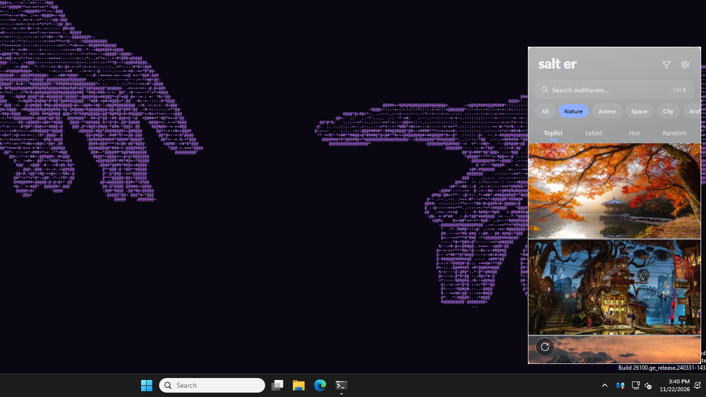
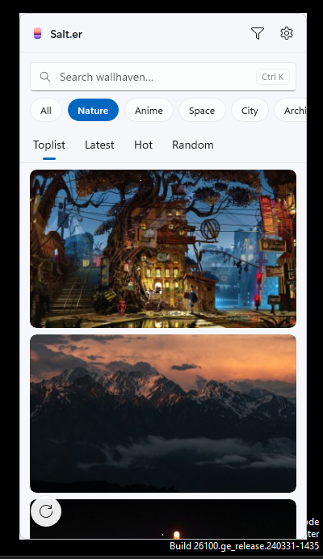
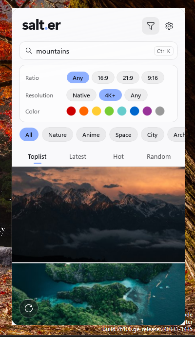
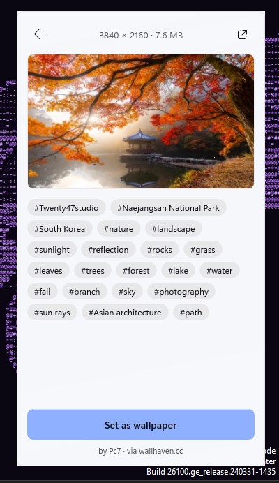
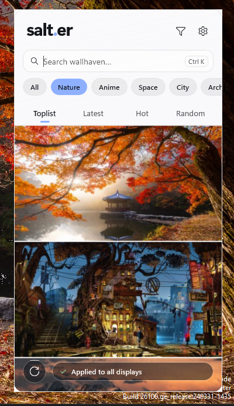
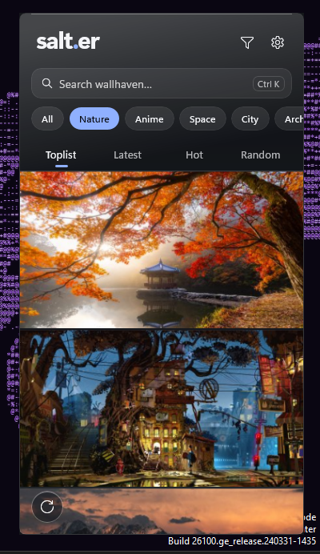
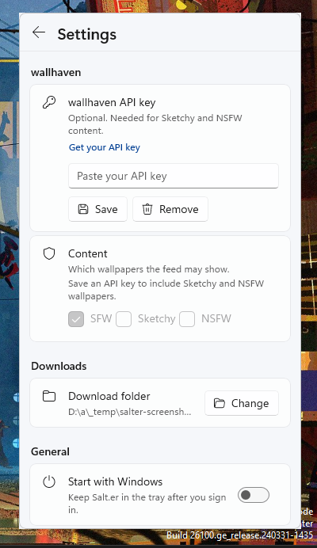

<p align="center">
  
</p>

<h1 align="center">salt.er</h1>

<p align="center">
  A minimal Windows tray app for finding and setting wallpapers from
  <a href="https://wallhaven.cc">wallhaven</a>.
</p>

<p align="center">
  <a href="https://github.com/tampleer981/salt.er/actions/workflows/ci.yml"></a>
  <a href="LICENSE"></a>
  
</p>

<p align="center">
  
</p>

Salt.er lives in the notification area. Click the tray icon, pick a wallpaper,
and it is on your desktop. There is no main window, no account and no
background activity beyond the tray icon. It uses about 50–120 MB of RAM.

## Features

### Browse

Four feeds: **Toplist** (the best of the last month), **Latest**, **Hot** and
**Random**. Thumbnails load as you scroll.

### Genres

Jump to **All**, **Nature**, **Anime**, **Space**, **City**, **Architecture**,
**Abstract**, **Cars** or **Minimal** with one click. Genres combine with every
feed.

<p align="center">
  <picture>
    <source media="(prefers-color-scheme: dark)" srcset="docs/assets/screenshots/genre-dark.png">
    <source media="(prefers-color-scheme: light)" srcset="docs/assets/screenshots/genre-light.png">
    
  </picture>
</p>

### Search and filters

Press <kbd>Ctrl</kbd>+<kbd>K</kbd> to search by keyword. Narrow the results by
aspect ratio (16:9, 21:9, or vertical 9:16), by resolution (at least your
display's native resolution, at least 4K, or any), and by dominant color.

<p align="center">
  <picture>
    <source media="(prefers-color-scheme: dark)" srcset="docs/assets/screenshots/search-filters-dark.png">
    <source media="(prefers-color-scheme: light)" srcset="docs/assets/screenshots/search-filters-light.png">
    
  </picture>
</p>

### Preview and set

Open a wallpaper to see it large, then set it on all displays or on one
display. Hover a thumbnail and click **Set** to apply it without opening the
preview. The image is downloaded at full resolution to your download folder.

<p align="center">
  <picture>
    <source media="(prefers-color-scheme: dark)" srcset="docs/assets/screenshots/detail-dark.png">
    <source media="(prefers-color-scheme: light)" srcset="docs/assets/screenshots/detail-light.png">
    
  </picture>
</p>

<p align="center">
  <picture>
    <source media="(prefers-color-scheme: dark)" srcset="docs/assets/screenshots/applied-dark.png">
    <source media="(prefers-color-scheme: light)" srcset="docs/assets/screenshots/applied-light.png">
    
  </picture>
</p>

### Light and dark

Salt.er follows the Windows app theme, or you can force light or dark in
Settings.

<p align="center">
  
  
</p>

### Settings

Choose the download folder, start Salt.er with Windows, set the theme, add an
optional wallhaven API key, and choose which content purity levels to browse.

<p align="center">
  <picture>
    <source media="(prefers-color-scheme: dark)" srcset="docs/assets/screenshots/settings-dark.png">
    <source media="(prefers-color-scheme: light)" srcset="docs/assets/screenshots/settings-light.png">
    
  </picture>
</p>

## Install

Salt.er supports Windows 10 (version 2004 or later) and Windows 11, on x64 and
ARM64.

| Resource | Typical use |
| --- | --- |
| Memory | 50–120 MB (lower while the flyout is hidden, higher with thumbnails loaded) |

### Installer (recommended)

1. Download `Salt.er-win-x64-Setup.exe` (or the `arm64` build) from
   [Releases](https://github.com/tampleer981/salt.er/releases).
2. Run it. Salt.er installs for your user, needs no administrator rights, and
   starts in the tray.

The installed app updates itself (see [Updates](#updates)).

### Portable ZIP

Download `Salt.er-<version>-win-<arch>-portable.zip` from
[Releases](https://github.com/tampleer981/salt.er/releases), extract it anywhere, and
run `Salter.App.exe`. The portable build never updates itself.

### winget

Planned. This section will show the command once the package is published.

### SmartScreen

Releases are not code-signed yet, so Windows may show **Windows protected your
PC** the first time you run the installer or the app. This is expected for
unsigned software.

1. Select **More info**.
2. Select **Run anyway**.

To confirm the download is the file that was published, compare its SHA-256
hash with the entry in `SHA256SUMS.txt` from the same release:

```powershell
Get-FileHash .\Salt.er-win-x64-Setup.exe -Algorithm SHA256
```

### Updates

An installed Salt.er updates itself silently, with nothing to click. It checks
GitHub Releases at startup and every six hours, downloads a newer stable release
in the background, and applies it the next time Salt.er starts (after a restart
or sign-in it comes back on the new version) or when you exit it from the tray
menu. Failures are logged and never interrupt you. The portable ZIP does not
check for updates.

## Usage

| Action | Result |
| --- | --- |
| Click the tray icon | Open or close the flyout |
| Right-click the tray icon | Open the menu: Open, Settings, Exit |
| <kbd>Ctrl</kbd>+<kbd>K</kbd> | Focus the search box |
| <kbd>Esc</kbd> | Go back one level; at the feed, hide the flyout |
| Hover a thumbnail, click **Set** | Set it as the wallpaper right away |
| Click a thumbnail | Open the preview |

The flyout also closes when it loses focus. Choose **Exit** in the tray menu to
quit.

## Configuration and data

Salt.er keeps everything under `%LOCALAPPDATA%\Salt.er`:

| Path | Content |
| --- | --- |
| `settings.json` | Download folder, start with Windows, theme, content purity |
| `logs\` | Daily log files, the last 7 days |

Wallpapers are saved to `%USERPROFILE%\Pictures\Salt.er` by default, as
`wallhaven-<id>.<ext>`. Change the folder in Settings.

### API key

A wallhaven API key is optional. Without one, Salt.er shows safe-for-work
wallpapers only and every other feature works. wallhaven requires a key for
Sketchy and NSFW content; create one in your
[wallhaven account settings](https://wallhaven.cc/settings/account), paste it
into Settings, and choose the purity levels to include. The key is stored in
Windows Credential Manager, never in `settings.json` or the logs, and is sent
only to wallhaven.

wallhaven limits each user to 45 API requests per minute. Salt.er stays under
that limit and honors `Retry-After` when wallhaven asks it to slow down.

### Privacy

Salt.er has no telemetry and no account. Its requests go directly to
`wallhaven.cc` (search and thumbnails) and, for updates in an installed copy,
to GitHub. Nothing is sent to the author. Uninstalling an installed copy
also deletes the API key from Windows Credential Manager and the start with
Windows entry.

## Non-goals

Salt.er stays small on purpose. These are not planned:

- Automatic wallpaper rotation or scheduled changes
- Slideshows
- Favorites, collections or history
- Lock screen wallpapers
- Sources other than wallhaven

## Building from source

You need Windows 11, the .NET 10 SDK and the Windows application development
tooling. See [docs/development.md](docs/development.md) for the build, test
and packaging commands, and [docs/architecture.md](docs/architecture.md) for
how the code is organized.

## Contributing

Bug reports, fixes and focused improvements are welcome. Read
[CONTRIBUTING.md](CONTRIBUTING.md) first, and open an issue before starting
anything large. Please follow the [Code of Conduct](CODE_OF_CONDUCT.md). Report
security problems as described in [SECURITY.md](SECURITY.md).

## Acknowledgements

Salt.er is inspired by the minimal approach of pap.er
for macOS. Wallpapers come from [wallhaven](https://wallhaven.cc) and belong to
their authors; each wallpaper's page links to its source.

## Disclaimer

Salt.er is an independent project. It is not affiliated with, endorsed by, or
sponsored by wallhaven.cc or pap.er.

## License

[MIT](LICENSE)
