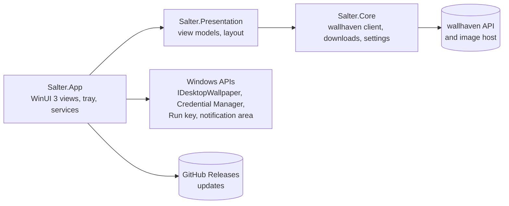

# Architecture

Salt.er is a tray application. Three projects keep the code that needs Windows
separate from the code that does not.

| Project | Target | Responsibility |
| --- | --- | --- |
| `Salter.Core` | `net10.0` | wallhaven client, feed queries, downloads, settings storage contracts |
| `Salter.Presentation` | `net10.0` | View models, layout math, and the interfaces the UI host implements |
| `Salter.App` | `net10.0-windows10.0.19041.0` | WinUI 3 views, tray icon, flyout window, Windows API integrations |

## Layers

Dependencies point one way. `Salter.Core` and `Salter.Presentation` know
nothing about WinUI. Where a view model needs the platform (setting the
wallpaper, enumerating monitors, showing a toast, picking a folder, registering
for startup), it depends on an interface in `Salter.Presentation/Abstractions`
and `Salter.App` supplies the Windows implementation. Secrets follow the same
pattern: `ISecretStore` is in Core, `CredentialSecretStore` in the App.

The views in `Salter.App/Views` use the WinUI default controls and theme
resources. Styles based on the defaults are in `App.xaml`, custom templates in
`Styles/Controls.xaml`, the few app colours in `Styles/Glass.xaml`, and all
implicit animations go through `Views/Motion.cs`; see [design.md](design.md).

### Why the view models are not in the App project

View models live in `Salter.Presentation` rather than `Salter.App`. A WinUI 3
project only builds on Windows, so keeping them in the App would leave the
interaction logic (stale-response handling, paging, apply flow) untestable on
Linux CI. As a separate `net10.0` project they are covered by
`tests/Salter.Presentation.Tests` on any OS. `Salt.er.Portable.slnf` lists the
projects that build everywhere.

## Data flow: search, feed, set

1. A genre, sort tab, filter or search text changes in `FeedViewModel`.
2. The view model cancels the request in flight and starts a new generation.
   `FeedRequestFactory` turns the genre, sort, filters and settings into a
   `SearchQuery` (for example Nature is the tag `nature` in the general
   category; All is general plus anime; the people category is never used).
   Excluded tags from the settings are appended to the search text as
   `-tag` terms (`nature -people -car`); `TagExclusions` keeps them to ten
   one-word tags, because wallhaven has no quoting for multi-word exclusions.
3. `WallhavenClient` sends the request through the handler pipeline below and
   deserializes the page of `WallpaperSummary` items.
4. The view model appends the items, skipping ids it already holds, and the
   view renders thumbnails. Scrolling near the end requests the next page,
   one page at a time. After **Refresh** on a sorted feed, the next page is
   the next of a random order of the first twenty pages, and each page's
   items are shuffled before they are appended.
5. Choosing **Set** calls `DetailViewModel`, which asks `IWallpaperDownloader`
   for the full-resolution file, writes it to the download folder, and passes
   the path to `IWallpaperService`. The Windows implementation calls
   `IDesktopWallpaper` for all displays or one.
6. Success or failure is reported through the toast service.

## Threading and cancellation

- Everything the user can trigger is asynchronous. The UI thread is never
  blocked on the network or the disk.
- Each feed reload creates a new generation with its own
  `CancellationTokenSource`. A response that belongs to a superseded
  generation is discarded, so switching genre or typing while a request is in
  flight never shows stale results.
- Page loads are single-flight: while one page is loading, further scroll
  events do not start another.
- Downloads write to a temporary file and move it into place on success, so a
  failed or cancelled download leaves no partial file. A whole-download
  deadline of 120 seconds ends stalled transfers.
- View models raise changes on the UI thread. The toast timer captures the
  creating `SynchronizationContext` and posts back to it.

## Network behavior

All wallhaven API requests share one pipeline, registered in
`Salter.Core/ServiceCollectionExtensions.cs`:

| Handler | Behavior |
| --- | --- |
| `ApiKeyHandler` | Adds `X-API-Key` when a key is configured |
| `RetryAfterHandler` | Retries HTTP 429 after `Retry-After` (10 s if absent, at most 60 s), up to twice |
| `RateLimitingHandler` | Token bucket, 45 requests per minute, shared by every request |
| `AttemptTimeoutHandler` | 20 seconds per attempt, so queueing and `Retry-After` waits do not count |

Image downloads use a separate `HttpClient` with a 60 second timeout. It has no
API key and no limiter because images come from a different host than the API.
Both clients recycle pooled connections every five minutes and send a
`Salt.er/<version>` user agent.

HTTP and transport failures are mapped to `WallhavenException` with a
`WallhavenErrorKind` (for example `Unauthorized` for a rejected key), which the
view models turn into error states with a retry action.

## Storage

| Data | Location |
| --- | --- |
| Settings | `%LOCALAPPDATA%\Salt.er\settings.json` |
| Logs | `%LOCALAPPDATA%\Salt.er\logs\` (daily files, 7 retained) |
| API key | Windows Credential Manager, generic credential `Salt.er/<name>` |
| Start with Windows | `HKCU\Software\Microsoft\Windows\CurrentVersion\Run` |
| Downloaded wallpapers | `%USERPROFILE%\Pictures\Salt.er` by default |

`settings.json` never contains the API key.

## Packaging and updates

`build/pack.ps1` publishes the app self-contained and unpackaged for one
architecture, zips the published folder as the portable build, packs it with
[Velopack](https://velopack.io) (pack id `Salt.er`, one channel per
architecture), and writes `SHA256SUMS.txt`. See
[releasing.md](releasing.md) and [ADR 0003](adr/0003-unsigned-unpackaged-distribution.md).

Velopack installs to `%LOCALAPPDATA%\Salt.er`, which is also the app data
folder; Velopack manages `current\`, `packages\` and `Update.exe`, and the
app's files do not overlap with them. The app always runs from
`current\Salter.App.exe`, so the Run key entry survives updates.

`UpdateService` runs only when Velopack reports the copy as installed. It checks
the repository's GitHub releases in the background at startup and every six
hours, and downloads a newer stable release. A downloaded update is applied with
no user action at whichever comes first:

- **Next start.** First thing in `App.Start`, once the process holds the
  single-instance key and before any UI exists, the app starts the updater with
  restart enabled and exits. The updater applies the update and starts the new
  version with the same launch mode (`--background` for the sign-in entry).
  Velopack's own apply-on-startup is off because it runs before the
  single-instance check and could end a running copy.
- **Exit from the tray menu.** The updater applies the update after the process
  ends, without restarting.

Failures are logged only.

## Single instance

`SingleInstance` makes a second launch hand its arguments to the running
instance and exit, so starting Salt.er twice opens the existing flyout.
